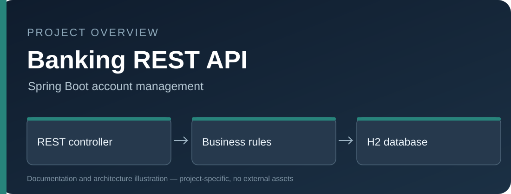

# Banking Management REST API



An educational **Java 17 / Spring Boot 4** REST API covering bank account creation, validation, deposits, withdrawals and transactional transfers.

## Features
- Layered Controller / Service / Repository architecture.
- Bean Validation for input, DTOs for API responses.
- Unique account numbers, insufficient-funds checks and global API errors.
- Transactional money movement with database row locking.
- JUnit 5 tests and GitHub Actions CI.

## Run
```bash
bash ./mvnw verify
bash ./mvnw spring-boot:run
```

Windows: `mvnw.cmd verify` and `mvnw.cmd spring-boot:run`.

## API routes

| Method | Endpoint | Purpose |
| --- | --- | --- |
| POST | `/api/accounts` | Create account |
| GET | `/api/accounts` | List accounts |
| GET | `/api/accounts/{id}` | Read account |
| POST | `/api/accounts/{id}/deposit` | Deposit funds |
| POST | `/api/accounts/{id}/withdraw` | Withdraw funds |
| POST | `/api/accounts/transfer` | Transfer funds |

HTTP Basic authentication is enabled for the demo. The in-memory H2 database is not durable. This project is **not production banking software**.
